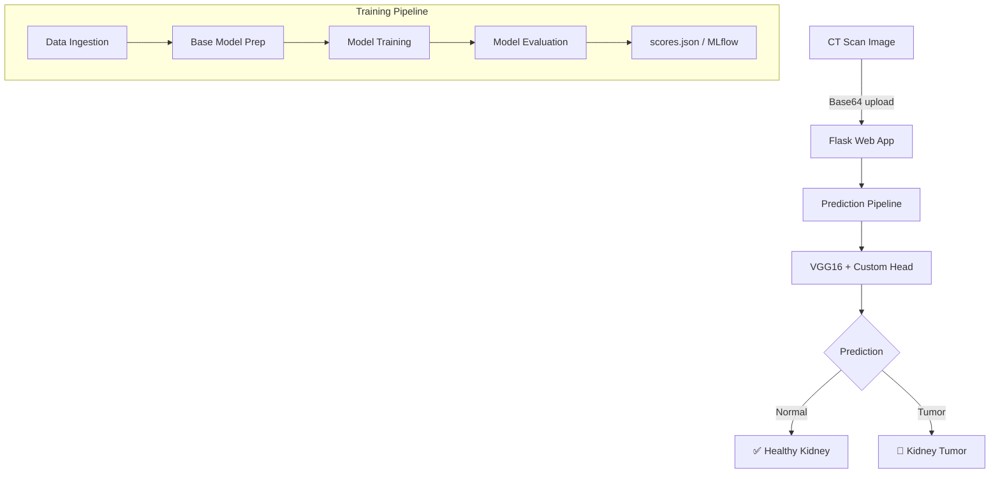

# 🩺 Kidney Disease Classification — Deep Learning Project Documentation

> **VGG16-based binary CT scan image classifier** | TensorFlow · Keras · MLflow · DVC · Flask

---

## Table of Contents
1. [Project Overview](#1-project-overview)
2. [Project Architecture](#2-project-architecture)
3. [Directory Structure](#3-directory-structure)
4. [Tech Stack & Dependencies](#4-tech-stack--dependencies)
5. [Data Pipeline (Stage 1 — Data Ingestion)](#5-data-pipeline-stage-1--data-ingestion)
6. [Model Architecture (Stage 2 — Base Model Preparation)](#6-model-architecture-stage-2--base-model-preparation)
7. [Training Pipeline (Stage 3 — Model Training)](#7-training-pipeline-stage-3--model-training)
8. [Evaluation Pipeline (Stage 4 — Model Evaluation)](#8-evaluation-pipeline-stage-4--model-evaluation)
9. [Evaluation Results & Metrics](#9-evaluation-results--metrics)
10. [Serving the Model (Flask App)](#10-serving-the-model-flask-app)
11. [Running the Project](#11-running-the-project)
12. [MLflow Experiment Tracking](#12-mlflow-experiment-tracking)
13. [DVC Pipeline Orchestration](#13-dvc-pipeline-orchestration)
14. [Key Design Decisions](#14-key-design-decisions)

---

## 1. Project Overview

This project classifies kidney CT scan images into **two categories**:
- **Normal** — healthy kidney
- **Tumor** — kidney with cancerous mass

The pipeline uses **transfer learning** (VGG16 pre-trained on ImageNet) fine-tuned on a custom dataset of kidney CT scans. The system is deployed as a **Flask web application** for real-time prediction via a browser interface.

---

## 2. Project Architecture



---

## 3. Directory Structure

```
Kidney-Disease-Classification-Deep-Learning-Project/
│
├── src/cnnClassifier/
│   ├── components/
│   │   ├── data_ingestion.py         # Downloads & extracts dataset
│   │   ├── prepare_base_model.py     # VGG16 setup + custom head
│   │   ├── model_training.py         # Trains with augmentation
│   │   └── model_evaluation_mlflow.py# Evaluates + logs to MLflow
│   │
│   ├── pipeline/
│   │   ├── stage_01_data_ingestion.py
│   │   ├── stage_02_prepare_base_model.py
│   │   ├── stage_03_model_training.py
│   │   ├── stage_04_model_evaluation.py
│   │   └── prediction.py             # Inference pipeline
│   │
│   ├── config/configuration.py       # Config manager
│   ├── entity/config_entity.py       # Typed config dataclasses
│   ├── constants/                    # Path constants
│   └── utils/common.py               # YAML/JSON utils, decode image
│
├── config/config.yaml                # All paths & URLs
├── params.yaml                       # All hyperparameters
├── dvc.yaml                          # DVC stage definitions
├── main.py                           # Full pipeline orchestrator
├── app.py                            # Flask production server
├── requirements.txt
├── Dockerfile
└── scores.json                       # Latest evaluation results
```

---

## 4. Tech Stack & Dependencies

| Category | Library | Version |
|---|---|---|
| Deep Learning | TensorFlow / Keras | 2.21.0 / 3.15.1 (training run) |
| Experiment Tracking | MLflow | 2.2.2 |
| Pipeline Versioning | DVC | latest |
| Data Download | gdown | latest |
| Web Serving | Flask + Flask-Cors | latest |
| Config Parsing | PyYAML, python-box | 6.0.2 |
| Metrics | scikit-learn (roc_auc) | — |
| Containerization | Docker | — |

---

## 5. Data Pipeline (Stage 1 — Data Ingestion)

**File:** [`stage_01_data_ingestion.py`](file:///c:/Users/chgya/Documents/Kidney-Disease-Classification-Deep-Learning-Project/src/cnnClassifier/pipeline/stage_01_data_ingestion.py)  
**Component:** [`data_ingestion.py`](file:///c:/Users/chgya/Documents/Kidney-Disease-Classification-Deep-Learning-Project/src/cnnClassifier/components/data_ingestion.py)

### What it does:
1. Downloads a **zipped dataset** from Google Drive using `gdown`
2. Extracts the ZIP into `artifacts/data_ingestion/`
3. Dataset folder structure after extraction:
   ```
   artifacts/data_ingestion/kidney-ct-scan-image/
   ├── Normal/          (CT scans of healthy kidneys)
   └── Tumor/           (CT scans with kidney tumors)
   ```

### Source URL
```yaml
source_URL: https://drive.google.com/file/d/1vlhZ5c7abUKF8xXERIw6m9Te8fW7ohw3/view?usp=sharing
```

### Configuration (`config.yaml`)
```yaml
data_ingestion:
  root_dir: artifacts/data_ingestion
  source_URL: https://drive.google.com/...
  local_data_file: artifacts/data_ingestion/data.zip
  unzip_dir: artifacts/data_ingestion
```

---

## 6. Model Architecture (Stage 2 — Base Model Preparation)

**File:** [`stage_02_prepare_base_model.py`](file:///c:/Users/chgya/Documents/Kidney-Disease-Classification-Deep-Learning-Project/src/cnnClassifier/pipeline/stage_02_prepare_base_model.py)  
**Component:** [`prepare_base_model.py`](file:///c:/Users/chgya/Documents/Kidney-Disease-Classification-Deep-Learning-Project/src/cnnClassifier/components/prepare_base_model.py)

### Architecture: VGG16 + Custom Classification Head

```
Input: (224, 224, 3)
      ↓
VGG16 (frozen, ImageNet weights)
  — 13 Convolutional layers
  — 5 Max Pooling layers
  — Output: (7, 7, 512) feature map
      ↓
Flatten → (25088,)
      ↓
Dense(units=2, activation='softmax')
      ↓
Output: [P(Normal), P(Tumor)]
```

### Key Design Choices

| Parameter | Value | Rationale |
|---|---|---|
| `include_top` | `False` | Remove ImageNet classification head |
| `weights` | `imagenet` | Transfer learning from large dataset |
| `freeze_all` | `True` | Only train the custom head (small dataset) |
| `learning_rate` | `0.0001` | Adam with a conservative rate for the classification head |
| `classes` | `2` | Binary classification |
| `image_size` | `[224, 224, 3]` | VGG16 standard input size |

---

## 7. Training Pipeline (Stage 3 — Model Training)

**File:** [`stage_03_model_training.py`](file:///c:/Users/chgya/Documents/Kidney-Disease-Classification-Deep-Learning-Project/src/cnnClassifier/pipeline/stage_03_model_training.py)  
**Component:** [`model_training.py`](file:///c:/Users/chgya/Documents/Kidney-Disease-Classification-Deep-Learning-Project/src/cnnClassifier/components/model_training.py)

### Data Splitting
| Split | Fraction | Usage |
|---|---|---|
| Training | 80% | Gradient updates |
| Validation | 20% | Epoch-level monitoring |

### Data Augmentation (when `AUGMENTATION: True`)

Applied only to the **training set** to reduce overfitting:

| Augmentation | Value |
|---|---|
| Rotation range | ±40° |
| Horizontal flip | Enabled |
| Width shift | 20% |
| Height shift | 20% |
| Shear range | 20% |
| Zoom range | 20% |
| Rescale | 1/255 |

### Training Hyperparameters (`params.yaml`)

```yaml
AUGMENTATION: True
IMAGE_SIZE: [224, 224, 3]
BATCH_SIZE: 16
INCLUDE_TOP: False
EPOCHS: 20
CLASSES: 2
WEIGHTS: imagenet
LEARNING_RATE: 0.0001
```

> [!NOTE]
> The classifier head is trained for **20 epochs** with Adam. The VGG16 feature extractor remains frozen.

### Training Process
```python
model.fit(
    train_generator,
    epochs=config.params_epochs,
    validation_data=valid_generator,
)
```

Keras iterates through all batches, including the final partial batch, for both training and validation.

### Output
- Trained model saved to: `artifacts/training/model.h5`

---

## 8. Evaluation Pipeline (Stage 4 — Model Evaluation)

**File:** [`stage_04_model_evaluation.py`](file:///c:/Users/chgya/Documents/Kidney-Disease-Classification-Deep-Learning-Project/src/cnnClassifier/pipeline/stage_04_model_evaluation.py)  
**Component:** [`model_evaluation_mlflow.py`](file:///c:/Users/chgya/Documents/Kidney-Disease-Classification-Deep-Learning-Project/src/cnnClassifier/components/model_evaluation_mlflow.py)

### How Evaluation Works

1. **Model Loading** — loaded with `compile=False` (Keras 3 compatibility fix) then recompiled
2. **Validation Generator** — uses the same 20% holdout as training-time validation (no shuffle, deterministic order)
3. **Standard Evaluation** — `model.evaluate()` → loss & accuracy
4. **Detailed Predictions** — `model.predict()` → class probabilities → argmax
5. **Confusion Matrix** — TP, TN, FP, FN computed against ground truth labels
6. **Clinical Metrics** — Precision, Recall, Specificity, F1, ROC-AUC
7. **Score Saving** — results written to `scores.json`
8. **MLflow Logging** — all metrics + params logged to MLflow server

### Evaluation Data Split
| Split | Fraction |
|---|---|
| Evaluation (validation) | 20% of total (93 images) |
| Used for training | 80% of total (372 images) |

### Metrics Computed

| Metric | Formula | Clinical Meaning |
|---|---|---|
| **Loss** | Cross-Entropy | Overall prediction error |
| **Accuracy** | (TP + TN) / Total | Overall correctness |
| **Precision** | TP / (TP + FP) | Of predicted tumors, how many are real |
| **Recall (Sensitivity)** | TP / (TP + FN) | Of actual tumors, how many were caught |
| **Specificity** | TN / (TN + FP) | Of healthy kidneys, how many correctly identified |
| **F1 Score** | 2 × (P × R) / (P + R) | Harmonic mean of precision & recall |
| **ROC-AUC** | Area under ROC curve | Overall discrimination ability (threshold-independent) |

---

## 9. Evaluation Results & Metrics

Results from the completed **20-epoch** run, evaluated by `stage_04_model_evaluation.py` on the 20% holdout. The holdout contains 93 images (48 Normal, 45 Tumor).

### Quantitative Results (`scores.json`)

| Metric | Value |
|---|---|
| **Loss** | 0.0709 |
| **Accuracy** | 100.00% |
| **Precision** | 1.000 |
| **Recall (Sensitivity)** | 1.000 |
| **Specificity** | 1.000 |
| **F1 Score** | 1.000 |
| **ROC-AUC** | 1.000 |

### Confusion Matrix

```
                  Predicted Normal   Predicted Tumor
Actual Normal          48 (TN)           0 (FP)
Actual Tumor            0 (FN)          45 (TP)
```

### Interpretation and Limitations

The 20-epoch run corrected the previous all-Normal predictions: all 93 holdout images were classified correctly. Training used Adam at a learning rate of 0.0001, 20 epochs, and the VGG16 backbone frozen.

> [!IMPORTANT]
> This is a small internal holdout from the same dataset, not an independent clinical test set. The 100% result should be validated on patient-level separated data from an external source before any clinical use. The earlier 1-epoch metrics used a 30% evaluation split, so its scores are not a perfectly matched benchmark.

---

## 10. Serving the Model (Flask App)

**File:** [`app.py`](file:///c:/Users/chgya/Documents/Kidney-Disease-Classification-Deep-Learning-Project/app.py)

### Endpoints

| Endpoint | Method | Description |
|---|---|---|
| `/` | GET | Renders the web UI (`templates/index.html`) |
| `/train` | GET/POST | Triggers `python main.py` (full pipeline rerun) |
| `/predict` | POST | Accepts base64 image, returns prediction JSON |

### Prediction Flow
```
POST /predict { "image": "<base64_string>" }
    ↓
decodeImage() → saves to inputImage.jpg
    ↓
PredictionPipeline.predict()
    ↓
Load model.h5 → preprocess → softmax → argmax
    ↓
Returns: [{"image": "Normal"}] or [{"image": "Tumor"}]
```

### Running the Server
```bash
python app.py
# App runs at http://0.0.0.0:8080
```

---

## 11. Running the Project

### Prerequisites
- Python 3.8+
- Git

### 1. Clone & Setup Environment

```bash
git clone <repository-url>
cd Kidney-Disease-Classification-Deep-Learning-Project

# Create virtual environment
python -m venv venv

# Activate (Windows PowerShell)
.\venv\Scripts\Activate.ps1

# Activate (macOS/Linux)
source venv/bin/activate

# Install dependencies
pip install -r requirements.txt
pip install scikit-learn   # for ROC-AUC metric
pip install mlflow         # if not already in requirements
```

### 2. Run Individual Pipeline Stages

```bash
# Stage 1: Data Ingestion (downloads dataset from Google Drive)
python src/cnnClassifier/pipeline/stage_01_data_ingestion.py

# Stage 2: Prepare Base Model (VGG16 + custom head)
python src/cnnClassifier/pipeline/stage_02_prepare_base_model.py

# Stage 3: Train the Model
python src/cnnClassifier/pipeline/stage_03_model_training.py

# Stage 4: Evaluate & Generate Metrics
python src/cnnClassifier/pipeline/stage_04_model_evaluation.py
```

### 3. Run Full Pipeline (All Stages)

```bash
python main.py
```

### 4. Run via DVC (Reproducible Pipelines)

```bash
# Run only changed stages
dvc repro

# Force rerun all stages
dvc repro --force
```

### 5. Launch Flask Web App

```bash
python app.py
# Open http://localhost:8080 in browser
```

### 6. View Evaluation Results

```bash
# See metrics
cat scores.json

# View DVC metrics
dvc metrics show
```

---

## 12. MLflow Experiment Tracking

The evaluation component logs all metrics and parameters to MLflow.

### Logged Parameters
All values from `params.yaml`:
- `IMAGE_SIZE`, `BATCH_SIZE`, `EPOCHS`, `AUGMENTATION`, `LEARNING_RATE`, etc.

### Logged Metrics
- `loss`, `accuracy`, `precision`, `recall`, `specificity`, `f1_score`, `roc_auc`

### Enable MLflow Logging

In `stage_04_model_evaluation.py`, uncomment:
```python
# evaluation.log_into_mlflow()
```
→ Change to:
```python
evaluation.log_into_mlflow()
```

### Launch MLflow UI

```bash
mlflow ui
# Open http://localhost:5000
```

---

## 13. DVC Pipeline Orchestration

DVC provides **data versioning** and **reproducible pipeline execution**.

### Pipeline Graph (`dvc.yaml`)

```
data_ingestion
      ↓
prepare_base_model
      ↓
training
      ↓
evaluation → scores.json (metric)
```

### Stage Dependencies

| Stage | Inputs | Outputs |
|---|---|---|
| `data_ingestion` | `config.yaml` | `artifacts/data_ingestion/kidney-ct-scan-image/` |
| `prepare_base_model` | config + params (IMAGE_SIZE, etc.) | `artifacts/prepare_base_model/` |
| `training` | config + params + data + base_model | `artifacts/training/model.h5` |
| `evaluation` | config + params + data + model.h5 | `scores.json` |

### Useful DVC Commands

```bash
dvc repro          # Run changed stages only
dvc status         # Show which stages are outdated
dvc metrics show   # Display scores.json
dvc dag            # Visualize the pipeline DAG
```

---

## 14. Key Design Decisions

| Decision | Choice | Reason |
|---|---|---|
| **Base Architecture** | VGG16 | Well-proven for medical imaging tasks |
| **Transfer Learning** | ImageNet weights, all layers frozen | Small medical dataset; avoid overfitting |
| **Augmentation** | Rotation, flip, zoom, shear | Increase effective dataset size |
| **Validation Split** | 20% for training-time validation and final evaluation | Consistent, non-overlapping holdout |
| **Metrics** | ROC-AUC + Precision/Recall/F1 | Critical for medical diagnosis (false negatives are costly) |
| **Tracking** | MLflow | Industry-standard experiment management |
| **Versioning** | DVC | Reproducible data + model pipeline |
| **Deployment** | Flask on port 8080 | Lightweight, Docker-compatible |
| **Keras Compat** | `compile=False` + recompile | Handles Keras 2→3 `reduction='auto'` breaking change |

---

*Documentation generated from live code analysis and successful pipeline execution.*  
*Evaluation completed: 2026-10-14 | Model: VGG16 + Dense(2) | Dataset: Kidney CT Scan Images*
